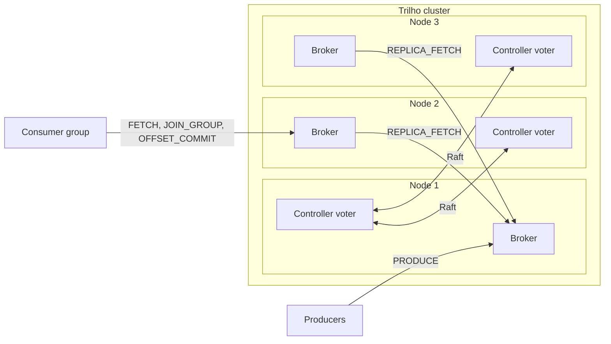

# Trilho

A distributed commit log built from scratch in Java 25: segmented storage, a binary protocol, consumer groups and Raft-based replication.

Trilho is Portuguese for rail track: records run on it in order, one after another.

[](docs/SPEC.md)
[](LICENSE)
[](https://openjdk.org/projects/jdk/25/)

> **Status: specification.** Nothing is implemented yet. The full plan lives in [docs/SPEC.md](docs/SPEC.md), and the work is tracked milestone by milestone in the [roadmap](#roadmap).

## What it is

Trilho is a small cluster of brokers that store streams of records and serve them to producers and consumers:

- **Storage:** append-only, segmented files with sparse, memory-mapped indexes. Crash recovery truncates torn writes.
- **Protocol:** its own versioned binary protocol over TCP, with pipelining and long-poll fetch.
- **Consumer groups:** a group coordinator divides partitions among members and stores committed offsets in an internal topic.
- **Replication:** pull-based, with high watermarks, in-sync replicas and leader epochs.
- **Metadata:** a Raft quorum implemented from the paper, with automatic failover of controllers and partition leaders.

The broker and the client library use only the JDK: no Netty, no frameworks, no logging library.

## What it is not

- **Not Kafka-compatible.** Kafka clients and tools will not talk to Trilho, by design.
- **Not a Kafka replacement.** Trilho is a learning-grade system, held to production standards of testing and measurement:
  - deterministic simulation;
  - fault injection with a history checker;
  - benchmarks with a published method.

## Architecture (planned)



Every node runs a broker and a controller voter. Followers pull from partition leaders, and the controllers keep cluster metadata in a Raft-replicated log.

## Highlights (planned)

- **Storage format with a checksum per batch.** CRC32C covers the producer's bytes, and the leader stamps offsets without recomputing it.
- **Zero-copy reads.** Fetch responses go from the segment file to the socket with `FileChannel.transferTo`.
- **One virtual thread per connection.** The choice is settled by a benchmark against an NIO selector and recorded in an ADR.
- **Memory-mapped indexes on the FFM API.** Unmapping is deterministic, so segment deletion also works on Windows.
- **`acks=0`, `1` and `all`.** `min.insync.replicas` is enforced, and unclean leader election is disabled.
- **Leader epochs.** After a failover, a follower whose log diverged truncates only uncommitted records.
- **Raft from the paper.** Elections, log replication, persisted term and vote, commit only through the current term.
- **Deterministic simulation.** Seeded message loss, reordering, partitions and crashes, with Raft and replication invariants checked after every step. Every failure replays from its seed.
- **History checker.** Proves that no acknowledged write is lost and that order is kept, across nightly fault injection runs.
- **Operations.** Prometheus metrics written without libraries, a Grafana dashboard, custom JFR events, a native CLI and a jlink container image.

## Roadmap

| Milestone | Outcome | Status |
|---|---|---|
| M0 · Foundation | Multi-module build, CI on Linux, macOS and Windows, dependency allow-list, ADRs | planned |
| M1 · Storage engine | Segments, indexes, crash recovery, retention, JMH benchmarks | planned |
| M2 · Single-node broker | Binary protocol, virtual-thread server, producer and consumer client, first CLI | planned |
| M3 · Consumer groups | Partitions, long-poll fetch, group coordinator, committed offsets | planned |
| M4 · Replication | Followers, high watermark, ISR, `acks=all`, leader epochs | planned |
| M5 · Raft and failover | Raft metadata quorum, broker fencing, automatic leader failover, simulation harness | planned |
| M6 · Operations | Metrics, dashboard, JFR, native CLI, container image, nightly fault runs, v0.1.0 | planned |
| M7 · Showcase | Benchmark report, design notes, recordings, case study | planned |
| M8 · Stretch | Idempotent producer, log compaction, Raft snapshots, TLS | planned |

## Planned usage

> Target CLI. None of these commands exist yet. They define what the milestones above deliver.

```sh
# start a three-node cluster with Prometheus and Grafana
docker compose -f deploy/compose.yml up -d

trilho topics create orders --partitions 6 --replication-factor 3 --bootstrap localhost:7070
printf 'c-42:{"total":120}\n' | trilho produce orders --key-separator=: --acks all
trilho consume orders --group billing --from earliest
trilho groups describe billing

# kill a node and watch partition leaders move
docker kill trilho-2
trilho cluster status --bootstrap localhost:7070

trilho perf produce orders --records 10000000 --record-size 100 --rate 100000 --acks all
```

## Documentation

- [Specification](docs/SPEC.md): requirements, storage format, wire protocol, architecture decisions, testing strategy and roadmap
- `docs/adr/`: architecture decision records, added as each decision is implemented
- `docs/design/`: design notes per subsystem, written as each one lands
- `docs/benchmarks.md`: method and results, published in M7

## Related projects

- [careflow](https://github.com/eduardo-alecrim/careflow)
- [legacy-modernization](https://github.com/eduardo-alecrim/legacy-modernization)
- [idempotency-kit](https://github.com/eduardo-alecrim/idempotency-kit)

## License

[Apache License 2.0](LICENSE).

Built by [Eduardo Alecrim](https://eduardo-alecrim.github.io).
