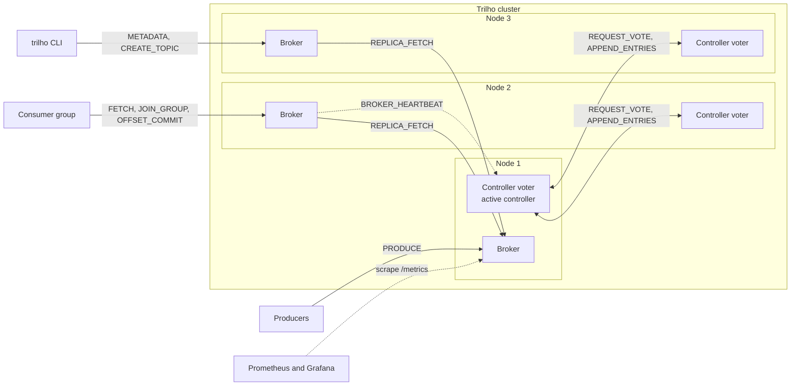
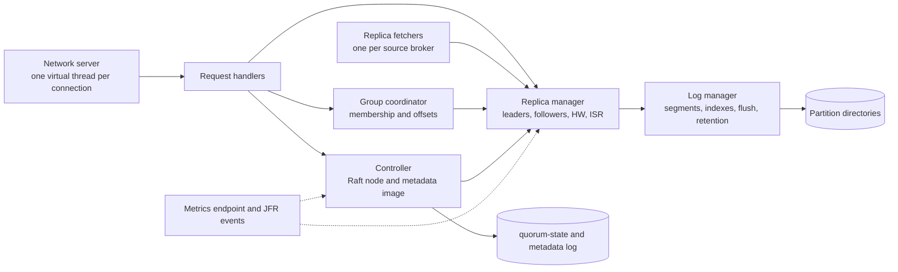
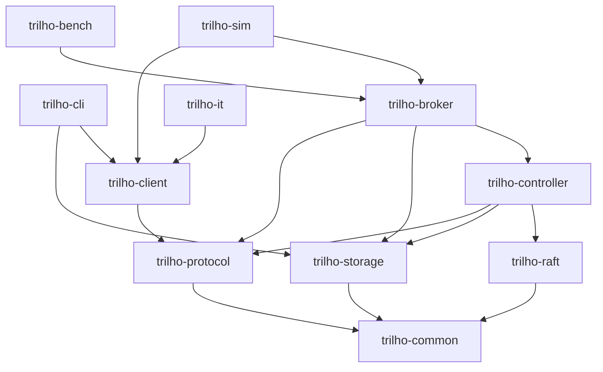
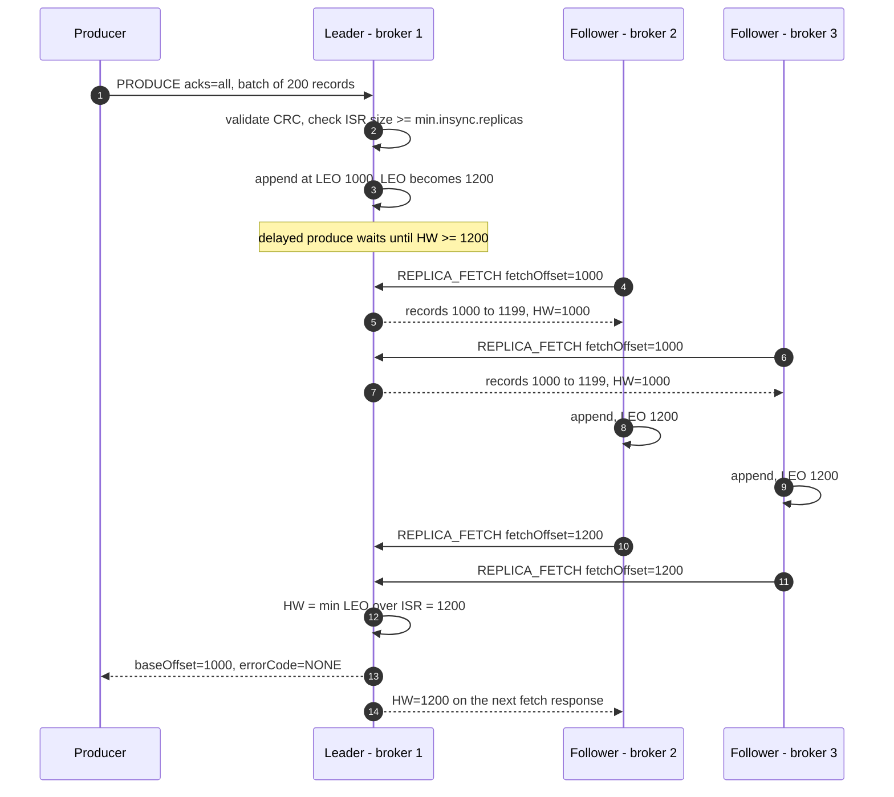
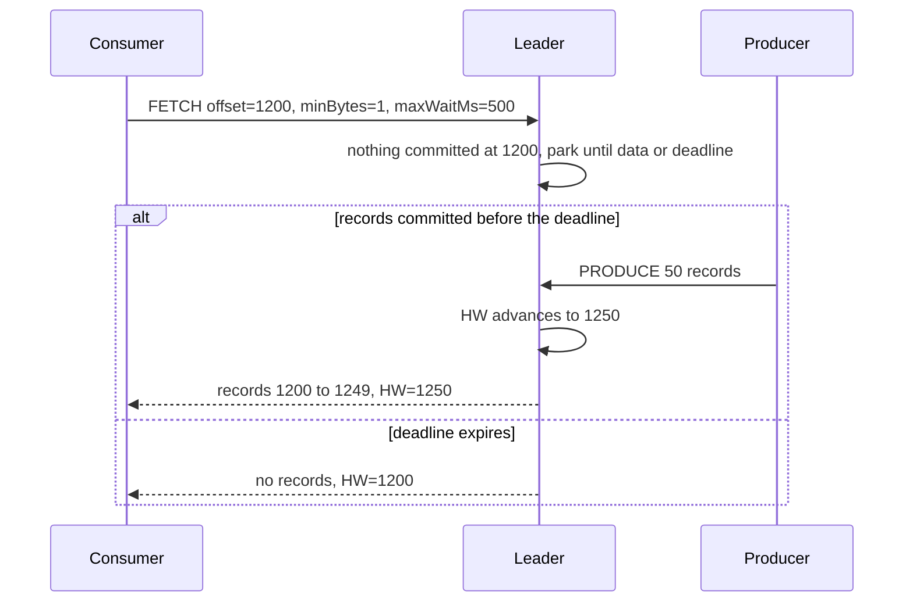
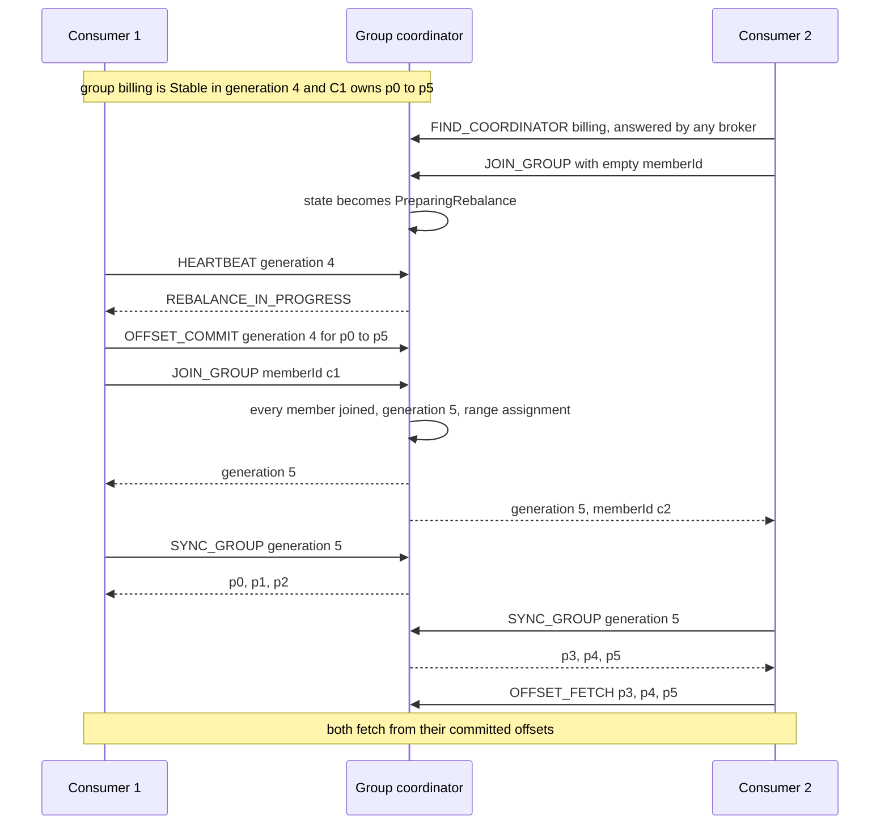
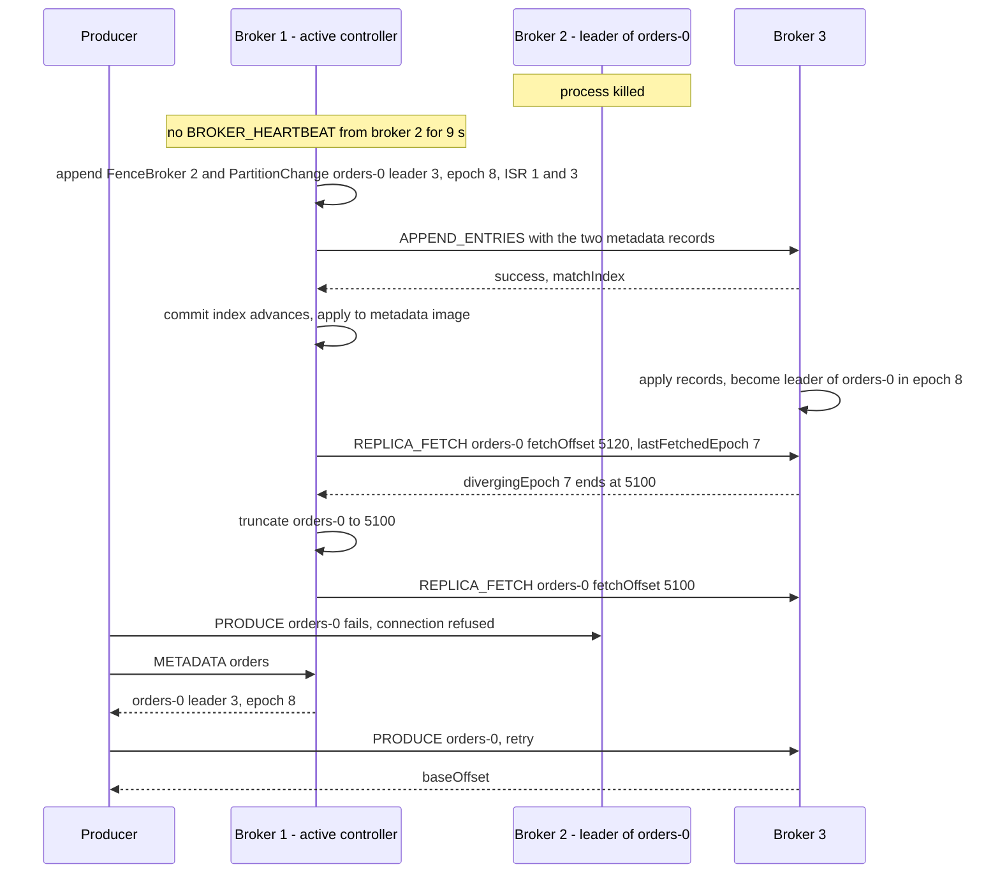
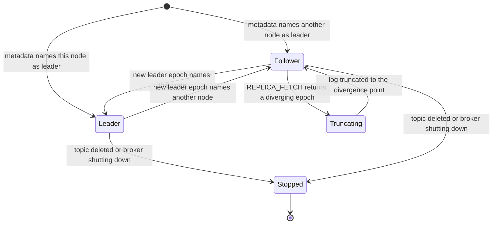
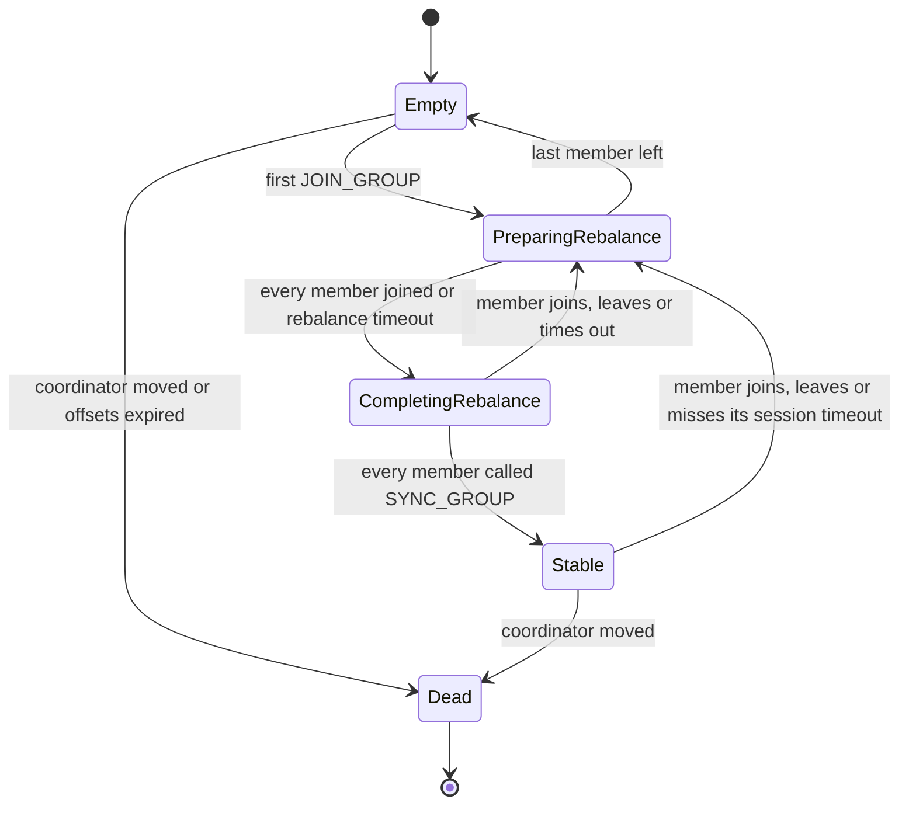
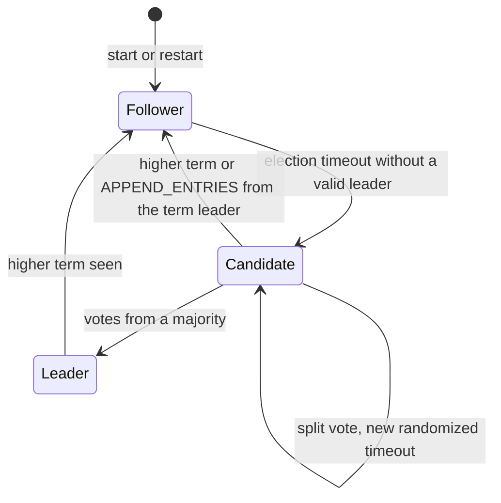

# Trilho specification

Trilho is a distributed commit log built from scratch in Java 25. A cluster of brokers stores records in append-only, segmented logs and serves them over its own binary protocol. It coordinates consumer groups, replicates every partition across nodes and keeps cluster metadata in a Raft quorum implemented from the paper. The broker and the client library depend on the JDK alone. The project exists to exercise the fundamentals: I/O, binary formats, concurrency, replication and consensus. Each correctness claim is checked by deterministic simulation and fault injection, and each performance claim is measured.

Status: specification · Last updated: 2026-10-13

## Contents

- [How to use this document](#how-to-use-this-document)
1. [Why this project](#1-why-this-project)
2. [Goals and non-goals](#2-goals-and-non-goals)
3. [Concepts and guarantees](#3-concepts-and-guarantees)
4. [Functional requirements](#4-functional-requirements)
5. [Architecture](#5-architecture)
6. [Storage format and wire protocol](#6-storage-format-and-wire-protocol)
7. [Technology choices and architecture decisions](#7-technology-choices-and-architecture-decisions)
8. [Non-functional requirements](#8-non-functional-requirements)
9. [Testing strategy](#9-testing-strategy)
10. [Engineering practices and CI/CD](#10-engineering-practices-and-cicd)
11. [Running](#11-running)
12. [Repository layout](#12-repository-layout)
13. [Roadmap](#13-roadmap)
14. [Showcase checklist](#14-showcase-checklist)
15. [Risks and mitigations](#15-risks-and-mitigations)
16. [Out of scope and future ideas](#16-out-of-scope-and-future-ideas)
17. [References](#17-references)

## How to use this document

- Each milestone in [section 13](#13-roadmap) is a checklist. Every unchecked item becomes a GitHub issue, labelled with its milestone (`M1`, `M2`, …) and its area (`storage`, `protocol`, `replication`, `raft`, `groups`, `client`, `ops`).
- One branch and one pull request per issue. Commits follow [Conventional Commits](https://www.conventionalcommits.org/): `feat(storage): roll segments by size`, `test(raft): add split-vote simulation`.
- Requirement ids (`FR-07`, `NFR-06`) and decision ids (`D-02`) are stable. Issues, pull requests, test names and ADRs reference them, for example `@DisplayName("FR-07 recovery truncates a torn batch")`.
- Each decision in [section 7](#7-technology-choices-and-architecture-decisions) becomes an ADR in `docs/adr/` when it is implemented. A change of plan is a new ADR plus an update to this document in the same pull request.
- When a subsystem lands, its design note goes in `docs/design/` (`storage.md`, `protocol.md`, `replication.md`, `raft.md`, `groups.md`, `simulation.md`). Design notes explain how the subsystem works. This document states what it must do.

## 1. Why this project

Commit logs sit underneath most event-driven systems, and running Kafka in production teaches its configuration. Building a log teaches why that configuration exists: why every batch carries a checksum that excludes the offset, why a write acknowledged with `acks=1` can disappear, why followers need leader epochs and not just the high watermark, why a consumer group needs generations. Trilho answers each of these in code, and each answer comes with a test that tries to break it.

| Skill area | Where it shows up |
|---|---|
| Binary formats and file I/O | Record batch format, zigzag varints, CRC32C, `FileChannel`, memory-mapped indexes through the FFM API, zero-copy `transferTo` |
| Concurrency | One virtual thread per connection, per-partition append locks, delayed operations for long-poll fetch and `acks=all` |
| Distributed consensus | Raft implemented from the paper for the metadata quorum: elections, log replication, persisted term and vote |
| Replication protocols | High watermark, in-sync replicas, leader epochs, divergent-log truncation, unclean election disabled |
| Protocol design | Versioned binary protocol, pipelining, error model with retriable codes, version negotiation |
| Library design | `trilho-client` producer, consumer and admin APIs, batching, retries, rebalance callbacks |
| Testing distributed systems | Deterministic simulation with seeded faults, container fault injection, a history checker, property-based tests |
| Performance engineering | JMH microbenchmarks, open-loop load generation, HdrHistogram with coordinated-omission correction, JFR |
| Operability | Prometheus metrics without libraries, Grafana dashboard, custom JFR events, controlled shutdown, one CLI |
| Delivery | GraalVM native CLI, jlink container image, CI on three operating systems, nightly fault runs, SBOM |

## 2. Goals and non-goals

### Goals

- **G-01** A single-node log that survives `kill -9` at any moment. It never serves corrupt data and never loses data that was fsynced.
- **G-02** A three-node cluster that never loses a write acknowledged with `acks=all` while at most one node fails.
- **G-03** Consumer groups that divide partitions among their members and resume from committed offsets after crashes and rebalances.
- **G-04** Automatic failover of partition leaders and of the controller, with no operator action.
- **G-05** Correctness claims checked every night by deterministic simulation and container fault injection.
- **G-06** Reproducible, published performance numbers with a documented method.
- **G-07** A complete operator experience: one CLI, metrics, a dashboard, JFR events and a container image.

### Non-goals

- Kafka wire compatibility. Kafka clients and tools do not work against Trilho (D-03).
- Transactions and exactly-once delivery across partitions.
- TLS and SASL, which are a stretch goal (M8) rather than a requirement.
- Tiered storage, a schema registry, quotas, partition reassignment and rack awareness.
- Feature parity with Kafka's KRaft mode. The metadata quorum covers what Trilho needs and no more.
- Compression codecs. The batch format reserves the bits, and v1 accepts only `none`.

## 3. Concepts and guarantees

### 3.1 Glossary

| Term | Meaning |
|---|---|
| Record | Key, value, headers and timestamp. The unit a producer writes. |
| Record batch | Records written, stored, replicated and fetched as one unit. Carries a CRC32C. |
| Topic | A named stream of records, split into partitions. |
| Partition | An ordered, append-only sequence of record batches. The unit of ordering, parallelism and replication. |
| Offset | `int64` position of a record in a partition. Assigned by the leader, contiguous, never reused. |
| Segment | One file of a partition's log (`.log`) with its offset and time indexes, named by its base offset. |
| Log start offset | The first offset still stored. It advances when retention deletes segments. |
| LEO | Log end offset: the offset the next appended record will get on a given replica. |
| High watermark (HW) | The first offset not yet stored on every ISR member. Records below it are committed and visible to consumers. |
| Replica | The copy of a partition held by one broker, either leader or follower. |
| ISR | In-sync replicas: the leader plus the followers that caught up with it within `replica.lag.time.max.ms`. |
| Leader epoch | `int32` that the controller increments whenever a partition gets a new leader. The leader stamps it on every batch it appends. |
| Partition epoch | `int32` incremented on every change to a partition's leader or ISR. Guards `ALTER_PARTITION` against stale updates. |
| Broker epoch | `int64` assigned at registration. Fences requests from a previous incarnation of the same broker. |
| Controller | The Raft leader of the metadata quorum. Decides topic placement, partition leaders and ISR changes. |
| Metadata log | The Raft-replicated log `__cluster_metadata` that holds the metadata records (section 6.11). |
| Metadata image | The in-memory state every node builds by applying committed metadata records. |
| Term | Raft's logical clock (`int32`). At most one Raft leader exists per term. |
| Commit index | The highest metadata log offset known to be stored on a majority of voters. |
| Consumer group | Consumers sharing a `group.id` that divide the partitions of their subscription among themselves. |
| Group coordinator | The broker that leads the group's `__offsets` partition. It manages membership and offsets. |
| Generation | `int32` incremented by every completed rebalance. Fences commits from stale members. |
| Committed offset | The next offset a group will consume in a partition. |

### 3.2 Ordering

- Within a partition, records are stored and delivered in offset order. Offsets are contiguous inside a batch and strictly increasing across batches.
- The default producer setting `max.in.flight.requests.per.connection=1` keeps the producer's send order per partition, retries included. The idempotent producer (M8) lifts the limit to 5 and still keeps the order.
- There is no ordering across partitions.

### 3.3 Durability by `acks`

| `acks` | The producer gets a success response when | An acknowledged record can still be lost when |
|---|---|---|
| `0` | The request is written to the socket. No response is sent. | Any failure occurs. |
| `1` | The leader appended the batch to its log. | The leader fails before a follower copies the batch and another replica becomes leader, which truncates the batch. Power loss before a flush also loses it. |
| `all` | Every ISR member stored the batch (the HW passed it) and the ISR had at least `min.insync.replicas` members. | Every replica holding the batch fails at the same moment, before an fsync, for example in a power loss. The flush policy `batch` closes this window. |

Unclean leader election is disabled. Only an ISR member can become leader, so an acknowledged `acks=all` batch survives as long as one ISR member that holds it survives.

### 3.4 Delivery semantics

- **Producer:** at least once. A retry after a timeout can duplicate a batch. The idempotent producer (M8) makes retries exactly once per partition.
- **Consumer:** at least once when it commits after processing, which is what auto-commit on `poll()` does. At most once when it commits before processing.
- **Visibility:** consumers only read below the HW, so a consumer never sees a record that a later truncation removes.
- **Metadata:** a `CREATE_TOPIC`, `DELETE_TOPIC` or leader change takes effect once its record is committed in the metadata log. Brokers learn about it by applying that record, so a client may briefly see stale metadata and must handle `NOT_LEADER` and `UNKNOWN_TOPIC_OR_PARTITION` by refreshing.

## 4. Functional requirements

Every requirement is testable. Test names carry the requirement id.

### 4.1 Storage

- **FR-01** Appending a batch assigns contiguous offsets starting at the partition's LEO. The broker overwrites `baseOffset` and `partitionLeaderEpoch` without recomputing the CRC, and returns the base offset.
- **FR-02** A read by offset returns whole batches, starting with the batch that contains the requested offset, up to `maxBytes`. It always returns at least one complete batch, even when that batch is larger than `maxBytes`. A read at LEO returns nothing. A read below the log start offset or above LEO fails with `OFFSET_OUT_OF_RANGE`.
- **FR-03** A partition rolls to a new segment when the next batch would exceed `segment.bytes`, the active segment is older than `segment.ms`, the index is full, or a relative offset would overflow `int32`.
- **FR-04** Looking up an offset uses a binary search over the sparse offset index, followed by a forward scan of at most `index.interval.bytes` plus one batch.
- **FR-05** `LIST_OFFSETS` with a timestamp `T` returns the earliest offset whose record timestamp is at or after `T`, found through the time index. The special values return `-1 = latest` (LEO) and `-2 = earliest` (log start offset).
- **FR-06** Retention deletes whole segments, never the active one, when they are older than `retention.ms` or when the partition exceeds `retention.bytes`. The log start offset advances to the base offset of the first remaining segment.
- **FR-07** After an unclean shutdown, recovery validates every batch after the recovery point and truncates the log at the first torn or corrupt batch.
  - *Given* a partition with 1,000 acknowledged batches under the flush policy `batch`, *when* the broker is killed while writing batch 1,001 and the last 37 bytes of the `.log` are garbage, *then* on restart the log holds exactly batches 1 to 1,000, the offset index agrees with the log, and the next append gets the next offset.
- **FR-08** The leader validates the CRC32C and structure of every batch on `PRODUCE`. It rejects a bad batch with `CORRUPT_RECORD` and leaves the log untouched.
- **FR-09** `log.flush.policy` controls fsync: `batch` syncs before acknowledging, `interval` syncs dirty partitions every `log.flush.interval.ms`, and `os` syncs only on roll and shutdown. The recovery point advances only on fsync.

### 4.2 Protocol and server

- **FR-10** Every request uses the frame in section 6.8. `API_VERSIONS` returns the supported version range of each API. An unknown API or version gets `UNSUPPORTED_VERSION`.
- **FR-11** A client may pipeline requests on one connection. The server processes them in order and answers in order, echoing each `correlationId`.
- **FR-12** A frame larger than `socket.request.max.bytes`, a negative length or a payload that does not parse ends the connection. In the last case the server first sends `INVALID_REQUEST`.

### 4.3 Topics and metadata

- **FR-13** `CREATE_TOPIC` validates the name (`[a-zA-Z0-9._-]{1,200}`, no `__` prefix), the partition count (at least 1) and the replication factor (at most the number of live brokers). It places replicas with the rule in section 6.11 and returns only after the topic record is committed.
- **FR-14** `DELETE_TOPIC` commits a `RemoveTopic` record. Each broker stops the partition's replicas, renames the directories to `<topic>-<n>.<topicId>-delete` and removes them in the background.
- **FR-15** `METADATA` returns the live brokers, the controller id and, per partition, the leader, leader epoch, replicas and ISR from the broker's metadata image.

### 4.4 Producer

- **FR-16** A keyed record goes to partition `floorMod(murmur3_32(keyBytes), partitionCount)`. Records without a key stick to one partition per batch, and the next batch rotates to the next partition.
- **FR-17** The producer accumulates records per partition. It sends a batch when it reaches `batch.size` or when `linger.ms` expires, whichever comes first. `buffer.memory` bounds memory and blocks `send()` up to `max.block.ms`.
- **FR-18** `acks` is honoured as described in section 3.3, and `acks=all` checks `min.insync.replicas` before and after appending.
  - *Given* topic `orders` with replication factor 3, `min.insync.replicas=2` and ISR {1,2,3}, *when* a producer sends a batch with `acks=all`, *then* the response arrives only after the HW passes the batch's last offset. With fewer than 2 ISR members, the leader answers `NOT_ENOUGH_REPLICAS` without appending.
- **FR-19** Retriable errors (section 6.10) trigger a metadata refresh and a retry with backoff (`retry.backoff.ms`, doubling up to 1 s) until `delivery.timeout.ms`. Non-retriable errors fail the record's future immediately.

### 4.5 Consumer and groups

- **FR-20** `FETCH` with `minBytes` and `maxWaitMs` parks on the leader until it has `minBytes` of committed data or the wait expires. Then it returns what it has, which may be nothing.
- **FR-21** Consumers never receive records at or above the HW.
- **FR-22** The coordinator assigns partitions with the group's `range` or `round-robin` assignor. All members must declare the same assignor, or the join fails with `INCONSISTENT_ASSIGNOR`.
  - *Given* group `billing` with 3 members subscribed to a 6-partition topic using `range`, *when* the rebalance completes in generation `g`, *then* each partition belongs to exactly one member, each member owns 2 partitions, and a commit carrying generation `g-1` fails with `ILLEGAL_GENERATION`.
- **FR-23** A rebalance starts when a member joins, leaves with `LEAVE_GROUP`, or misses heartbeats for `session.timeout.ms`. Members learn about it from `REBALANCE_IN_PROGRESS` on `HEARTBEAT` and rejoin. A member that does not rejoin within `rebalance.timeout.ms` is removed.
- **FR-24** Offsets committed with `OFFSET_COMMIT` are appended to `__offsets` with `acks=all` and survive coordinator failover.
  - *Given* a group that committed offset 500 for `orders-0`, *when* the coordinator broker is killed and leadership of the group's `__offsets` partition moves, *then* the new coordinator answers `COORDINATOR_LOAD_IN_PROGRESS` while replaying the partition, and `500` afterwards.
- **FR-25** Without a committed offset, or when the committed offset is out of range, the consumer starts at `auto.offset.reset`: `earliest`, `latest` or `none`. With `none` it fails.

### 4.6 Replication

- **FR-26** Followers replicate with `REPLICA_FETCH`. The leader tracks each follower's LEO from its `fetchOffset` and sets the HW to the minimum LEO across the ISR. Followers learn the HW from the responses.
- **FR-27** The leader asks the controller to drop a follower from the ISR once it has lagged the leader's LEO for more than `replica.lag.time.max.ms`. It asks to add the follower back once its LEO reaches the HW in the current leader epoch. Both changes go through `ALTER_PARTITION` and are guarded by the partition epoch.
- **FR-28** A follower whose log diverged from the new leader's is truncated using leader epochs, never using its own HW.
  - *Given* broker 1, a follower, holding records up to 5,119 in epoch 7, and the new leader, broker 3, whose epoch 7 ended at 5,100, *when* broker 1 fetches with `lastFetchedEpoch=7` and `fetchOffset=5120`, *then* broker 3 answers `divergingEpoch=7, divergingEndOffset=5100`, and broker 1 truncates to 5,100 and fetches again from there. No offset below the HW is ever truncated.
- **FR-29** The controller only elects an ISR member as leader. With no live ISR member, the partition stays offline (`LEADER_NOT_AVAILABLE`) until one returns.

### 4.7 Controller and cluster membership

- **FR-30** The voters run Raft as specified in the paper's Figure 2: randomized election timeouts, `REQUEST_VOTE` with the log up-to-date check, `APPEND_ENTRIES` with the consistency check, and a commit index advanced only by entries of the current term.
  - *Given* 3 voters, *when* the leader is partitioned from the other two, *then* they elect a new leader in a higher term, the old leader steps down as soon as it sees that term, and entries appended only on the old leader are never committed.
- **FR-31** Each broker registers with `REGISTER_BROKER`, receives a broker epoch and sends `BROKER_HEARTBEAT` every `broker.heartbeat.interval.ms`. The controller fences a broker after `broker.session.timeout.ms` without a heartbeat, and unfences it when heartbeats resume and its metadata offset has caught up.
- **FR-32** When a broker is fenced, the controller commits a `PartitionChange` for every partition that broker led. Each change names a live ISR member as leader with `leaderEpoch+1` and removes the fenced broker from the ISR.
  - *Given* a 3-node cluster and a producer writing with `acks=all` to a partition led by broker 2, *when* broker 2 is killed, *then* the controller elects an ISR member, the producer's retries succeed against the new leader, and a full read finds every acknowledged record.
- **FR-33** On SIGTERM, a broker performs a controlled shutdown within `shutdown.controlled.timeout.ms`: it sends `BROKER_HEARTBEAT` with `wantShutdown=true`, waits for the controller to move every leadership it holds, stops its replicas, flushes all logs, writes the checkpoints and `.clean-shutdown`, and exits.

### 4.8 Operations

- **FR-34** The `trilho` CLI provides `topics create|list|describe|delete`, `produce` (stdin, `--key-separator`), `consume` (`--group`, `--from earliest|latest|<offset>`), `groups list|describe`, `cluster status`, `partitions elect-leader`, `log dump [--verify]` and `perf produce|consume`. It exits non-zero with a one-line message on any error.
- **FR-35** Every node serves metrics in the Prometheus text exposition format at `GET /metrics` on `metrics.listener`, and `GET /health` returns 200 once the node has caught up with the metadata log.
- **FR-36** The broker emits custom JFR events: `trilho.SegmentRoll`, `trilho.Fsync` (with duration and bytes), `trilho.ReplicaLag`, `trilho.Rebalance` and `trilho.RaftElection`.

### 4.9 Stretch (M8)

- **FR-37** Idempotent producer: `INIT_PRODUCER_ID` assigns a producer id and each batch carries `producerId` and `baseSequence`. The leader keeps the last 5 batch sequences per producer and partition, answers a duplicate with `DUPLICATE_SEQUENCE` and the original offset, and a gap with `OUT_OF_ORDER_SEQUENCE`.
- **FR-38** Log compaction: with `cleanup.policy=compact`, a cleaner keeps only the latest record per key in closed segments, and `__offsets` switches to compaction.

## 5. Architecture

### 5.1 Cluster

Every node runs a broker and, if it is listed in `controller.quorum.voters`, a controller voter. The reference cluster has three nodes, all voters. Nodes outside the voter set are observers that pull the metadata log with `METADATA_FETCH`.



### 5.2 Inside a node



Threading model:

| Component | Threads | Rule |
|---|---|---|
| Connections | One virtual thread per connection on a blocking `ServerSocketChannel` (D-02) | Read a frame, handle it, write the response, read the next: in-order pipelining (FR-11) for free |
| Delayed operations | The connection's own virtual thread, parked on a per-partition condition with a deadline | An append wakes waiting fetches, an HW advance completes waiting `acks=all` produces. A parked virtual thread is cheap, so no purgatory structure is needed. |
| Appends | The caller's thread, under a per-partition `ReentrantLock` | The lock covers offset assignment, the channel write and the index update. Reads never lock: they read the `volatile` LEO and HW. |
| Replica fetchers | One platform thread per source broker | All partitions followed from one broker share one `REPLICA_FETCH` |
| Raft core | One dedicated thread draining an inbox of messages and ticks | The core never blocks and never reads the clock (D-08) |
| Background | One scheduled executor | Flusher, retention checker, checkpoint writers |

### 5.3 Modules

Arrows point from a module to the modules it depends on.



| Module | Responsibility | Runtime dependencies |
|---|---|---|
| `trilho-common` | Varint and zigzag codecs, checksums, configuration parsing, error codes, `Clock`, `TopicPartition` | JDK |
| `trilho-protocol` | Frame codec, primitive types, request and response records for every API, versions | JDK |
| `trilho-storage` | Log, segments, offset and time indexes, recovery, retention, flush, checkpoints | JDK |
| `trilho-raft` | Pure Raft state machine (`step`, `tick`) behind `RaftLog`, `QuorumStateStore` and `Transport` interfaces | JDK |
| `trilho-controller` | Metadata records, metadata image, placement, fencing, leader election, `RaftLog` on `trilho-storage` | JDK |
| `trilho-broker` | Network server, request handlers, replica manager, fetchers, group coordinator, metrics, JFR, `main` | JDK |
| `trilho-client` | Producer, consumer, admin client, metadata cache, connection management | JDK |
| `trilho-cli` | `trilho` command, perf tool, log dump | picocli, HdrHistogram |
| `trilho-sim` | Deterministic simulation harness and history checker (test scope) | JDK, test libraries |
| `trilho-it` | Testcontainers integration and fault-injection tests | Test libraries |
| `trilho-bench` | JMH benchmarks | JMH |

Packages live under `io.github.eduardoalecrim.trilho`.

### 5.4 Produce with `acks=all`



### 5.5 Long-poll fetch



### 5.6 Group rebalance



The coordinator accepts `OFFSET_COMMIT` for the current generation while it is `PreparingRebalance`, so that members can commit before rejoining. It rejects commits with `REBALANCE_IN_PROGRESS` while it is `CompletingRebalance`.

### 5.7 Partition leader failover



Records 5,100 to 5,119 never reached the HW, so no producer received an `acks=all` success for them. Truncating them loses nothing that was acknowledged.

### 5.8 State machines

Partition replica on a broker:



Consumer group on its coordinator:



Raft role of a voter:



## 6. Storage format and wire protocol

All integers are big-endian. Varints use zigzag encoding followed by base-128 groups, as in Protocol Buffers `sint32` and `sint64`.

### 6.1 On-disk layout

```text
data/
├── meta.properties                  # cluster.id, node.id, format version
├── quorum-state                     # Raft currentTerm and votedFor (voters only)
├── recovery-point-checkpoint        # partition -> last fsynced offset
├── replication-offset-checkpoint    # partition -> high watermark
├── log-start-offset-checkpoint      # partition -> log start offset
├── .clean-shutdown                  # present only after a graceful shutdown
├── __cluster_metadata-0/            # Raft metadata log, same format as any partition
├── __offsets-3/
└── orders-0/
    ├── partition.metadata           # topicId (UUID), guards against reusing a deleted topic's data
    ├── leader-epoch-checkpoint      # epoch -> start offset
    ├── 00000000000000000000.log
    ├── 00000000000000000000.index
    ├── 00000000000000000000.timeindex
    └── 00000000000000052311.log     # next segment, with its own .index and .timeindex
```

Segment files are named after the segment's base offset, zero-padded to 20 digits. Checkpoint files are text: a version line, an entry count, then one `topic partition value` line per entry. Every checkpoint is written to a temporary file, fsynced, atomically renamed over the old file, and then the directory is fsynced.

### 6.2 Primitive types

| Type | Encoding |
|---|---|
| `int8`, `int16`, `int32`, `int64` | Fixed width, big-endian, two's complement |
| `varint`, `varlong` | Zigzag plus base-128, 1 to 5 or 1 to 10 bytes |
| `bool` | `int8`: 0 or 1 |
| `string` | `int16` length plus UTF-8 bytes. Length -1 means null. |
| `bytes` | `int32` length plus raw bytes. Length -1 means null. |
| `array<T>` | `int32` count plus elements. Count -1 means null. |
| `uuid` | 16 bytes |

### 6.3 Record batch

| Offset | Field | Type | Notes |
|---|---|---|---|
| 0 | `baseOffset` | `int64` | Assigned by the leader on append |
| 8 | `batchLength` | `int32` | Bytes from offset 12 to the end of the batch |
| 12 | `partitionLeaderEpoch` | `int32` | Stamped by the leader. In the metadata log it holds the Raft term. |
| 16 | `crc` | `uint32` | CRC32C of the bytes from offset 20 to the end of the batch |
| 20 | `attributes` | `int16` | Bits 0 to 2: compression (0 = none, the only value in v1). Bits 3 to 15: reserved, must be 0. |
| 22 | `lastOffsetDelta` | `int32` | `recordCount - 1` |
| 26 | `firstTimestamp` | `int64` | Milliseconds since the epoch |
| 34 | `maxTimestamp` | `int64` | Largest record timestamp in the batch |
| 42 | `producerId` | `int64` | -1 unless the producer is idempotent (M8) |
| 50 | `baseSequence` | `int32` | -1 unless the producer is idempotent (M8) |
| 54 | `recordCount` | `int32` | At least 1 |
| 58 | `records` | | `recordCount` records, see 6.4 |

The CRC excludes `baseOffset`, `batchLength` and `partitionLeaderEpoch`. The producer computes it, every broker verifies it, and the leader stamps the excluded fields without recomputing it (D-06). `producerId` and `baseSequence` exist from v1 so that the idempotent producer does not need an on-disk format change (D-13).

### 6.4 Record

| Field | Type | Notes |
|---|---|---|
| `length` | `varint` | Bytes after this field |
| `timestampDelta` | `varlong` | Relative to `firstTimestamp` |
| `offsetDelta` | `varint` | Relative to `baseOffset` |
| `keyLength` | `varint` | -1 means a null key |
| `key` | bytes | |
| `valueLength` | `varint` | -1 means a null value (a tombstone under compaction) |
| `value` | bytes | |
| `headerCount` | `varint` | |
| `headerKeyLength`, `headerKey` | `varint`, UTF-8 | Repeated `headerCount` times, together with the next two fields |
| `headerValueLength`, `headerValue` | `varint`, bytes | -1 means a null header value |

### 6.5 Indexes

Offset index entry (`.index`, 8 bytes):

| Offset | Field | Type | Notes |
|---|---|---|---|
| 0 | `relativeOffset` | `int32` | Batch `baseOffset` minus the segment base offset |
| 4 | `position` | `int32` | Byte position of the batch in `.log` |

Time index entry (`.timeindex`, 12 bytes):

| Offset | Field | Type | Notes |
|---|---|---|---|
| 0 | `timestamp` | `int64` | Largest timestamp in the segment up to this batch |
| 8 | `relativeOffset` | `int32` | `baseOffset` of that batch minus the segment base offset |

- **When entries are written.** The segment writes an offset index entry for a batch once at least `index.interval.bytes` have been appended since the previous entry. A time index entry is written only when the segment's largest timestamp grows.
- **Mapping and growth.** Both indexes are preallocated to `segment.index.bytes` and mapped through `FileChannel.map(..., Arena)` (D-07). They are trimmed to their real size when the segment rolls or closes.
- **Lookup.** An offset lookup binary-searches for the greatest entry at or below the target, then scans `.log` forward from that position.

### 6.6 Write path, recovery and retention

- **Append.** Under the partition lock, the leader stamps `baseOffset` and `partitionLeaderEpoch`, writes the batch with `FileChannel.write` at the end of the active segment, adds index entries if they are due, fsyncs if the policy is `batch`, advances LEO and wakes parked fetches.
- **Read.** A read finds the segment with a floor lookup on base offsets, then the position through the index. It returns a file region (segment, position, length). The network layer sends that region with `FileChannel.transferTo` straight to the socket, so the record bytes never enter the heap.
- **Recovery.** A missing `.clean-shutdown` means the shutdown was unclean. For every partition, recovery starts at the last index entry at or below the recovery point (indexes are flushed with the log, so those entries are trustworthy) and scans batches, checking that `batchLength` is between 46 and `max.batch.bytes`, the batch fits inside the file, the CRC matches and `baseOffset` equals the expected next offset. At the first failure it truncates `.log`, drops index entries beyond that point, rebuilds the missing ones, deletes any later segments and rewrites the recovery-point checkpoint.
- **Retention.** Every `retention.check.interval.ms`, the retention checker selects closed segments that break `retention.ms` (by `maxTimestamp`) or `retention.bytes` (oldest first). It advances the log start offset, renames the segments to `.deleted` and removes them asynchronously.
- **Leader epoch history.** When a leader appends its first batch in a new epoch, it records `epoch -> startOffset` in `leader-epoch-checkpoint`, with an fsync. A follower records the same thing on its first batch of an epoch. When a log is truncated, entries beyond the new LEO are removed.

### 6.7 Configuration

Node configuration (`server.properties`):

| Key | Default | Meaning |
|---|---|---|
| `cluster.id` | required | Must match `meta.properties`. A node from another cluster refuses to start. |
| `node.id` | required | Unique `int32` |
| `data.dir` | `./data` | Root of the on-disk layout |
| `listeners` | `0.0.0.0:7070` | Client and inter-broker listener |
| `advertised.listener` | `localhost:7070` | Address published in metadata |
| `controller.listener` | `0.0.0.0:7071` | Raft and controller traffic (D-12) |
| `controller.quorum.voters` | required | `1@n1:7071,2@n2:7071,3@n3:7071` |
| `metrics.listener` | `0.0.0.0:7080` | `/metrics` and `/health` |
| `socket.request.max.bytes` | `16777216` | Largest accepted frame |
| `segment.bytes` | `134217728` | 128 MiB |
| `segment.ms` | `604800000` | 7 days |
| `segment.index.bytes` | `10485760` | Preallocated index size |
| `index.interval.bytes` | `4096` | Bytes between offset index entries |
| `max.batch.bytes` | `1048576` | Largest accepted batch |
| `retention.ms` | `604800000` | 7 days. -1 keeps data forever. |
| `retention.bytes` | `-1` | Per partition. -1 means no limit. |
| `retention.check.interval.ms` | `60000` | |
| `log.flush.policy` | `interval` | `batch`, `interval` or `os` (D-15) |
| `log.flush.interval.ms` | `1000` | Used by the `interval` policy |
| `default.replication.factor` | `3` | Capped at the number of live brokers |
| `min.insync.replicas` | `2` | |
| `replica.lag.time.max.ms` | `10000` | ISR shrink threshold |
| `replica.fetch.max.wait.ms` | `500` | Follower long-poll |
| `replica.fetch.max.bytes` | `1048576` | Per partition |
| `broker.heartbeat.interval.ms` | `2000` | |
| `broker.session.timeout.ms` | `9000` | Fencing threshold |
| `controller.election.timeout.ms` | `1000` | Randomized in `[T, 2T]` |
| `controller.heartbeat.interval.ms` | `200` | Empty `APPEND_ENTRIES` from the leader |
| `offsets.topic.partitions` | `8` | Partitions of `__offsets` |
| `group.min.session.timeout.ms` | `6000` | |
| `group.max.session.timeout.ms` | `60000` | |
| `group.initial.rebalance.delay.ms` | `1000` | Lets a group form before the first assignment |
| `shutdown.controlled.timeout.ms` | `30000` | |

Topic overrides at creation: `segment.bytes`, `segment.ms`, `retention.ms`, `retention.bytes`, `min.insync.replicas` and `cleanup.policy` (`delete`, or `compact` from M8). `__offsets` uses `retention.ms=-1` until compaction exists.

Client defaults:

- **Producer:** `acks=all`, `batch.size=16384`, `linger.ms=5`, `buffer.memory=33554432`, `max.block.ms=60000`, `request.timeout.ms=30000`, `delivery.timeout.ms=120000`, `retry.backoff.ms=100`, `max.in.flight.requests.per.connection=1`, `enable.idempotence=false` (true from M8).
- **Consumer:** `enable.auto.commit=true`, `auto.commit.interval.ms=5000`, `auto.offset.reset=latest`, `fetch.min.bytes=1`, `fetch.max.wait.ms=500`, `max.partition.fetch.bytes=1048576`, `session.timeout.ms=10000`, `heartbeat.interval.ms=3000`, `rebalance.timeout.ms=60000`, `assignor=range`.

### 6.8 Frames

Request frame:

| Offset | Field | Type | Notes |
|---|---|---|---|
| 0 | `length` | `int32` | Bytes after this field |
| 4 | `apiKey` | `int16` | Section 6.9 |
| 6 | `apiVersion` | `int16` | All APIs start at version 0 |
| 8 | `correlationId` | `int32` | Chosen by the client and echoed in the response |
| 12 | `payload` | | Request body for the API and version |

The response frame is `length int32` (bytes after this field), `correlationId int32` (same as the request) and the response payload, which carries error codes per element. `acks=0` produce requests get no response, and clients do not assign them a pending slot.

### 6.9 APIs

`[...]` is an array and `?` a nullable field. Error codes live in each response element.

| Key | API | Since | Request | Response |
|---|---|---|---|---|
| 0 | `PRODUCE` | M2 | `acks int16, timeoutMs int32, [topic string, [partition int32, records bytes]]` | `[topic, [partition, errorCode int16, baseOffset int64, logStartOffset int64]]` |
| 1 | `FETCH` | M2 (long-poll in M3) | `maxWaitMs int32, minBytes int32, maxBytes int32, [topic, [partition, currentLeaderEpoch int32, fetchOffset int64, partitionMaxBytes int32]]` | `[topic, [partition, errorCode, highWatermark int64, logStartOffset int64, records bytes]]` |
| 2 | `LIST_OFFSETS` | M2 | `[topic, [partition, timestamp int64]]` | `[topic, [partition, errorCode, offset int64, timestamp int64]]` |
| 3 | `METADATA` | M2 | `topics [string]?` | `brokers [nodeId int32, host string, port int32], controllerId int32, [topic: errorCode, name, topicId uuid, [partition: errorCode, index int32, leaderId int32, leaderEpoch int32, replicas [int32], isr [int32]]]` |
| 4 | `CREATE_TOPIC` | M2 | `name, partitions int32, replicationFactor int16, configs [key string, value string], timeoutMs int32` | `errorCode, errorMessage string?` |
| 5 | `DELETE_TOPIC` | M3 | `name, timeoutMs` | `errorCode` |
| 6 | `API_VERSIONS` | M2 | empty | `errorCode, [apiKey int16, minVersion int16, maxVersion int16]` |
| 10 | `FIND_COORDINATOR` | M3 | `groupId string` | `errorCode, nodeId, host, port` |
| 11 | `JOIN_GROUP` | M3 | `groupId, memberId (empty on first join), clientId, sessionTimeoutMs, rebalanceTimeoutMs, assignor string, topics [string]` | `errorCode, generationId int32, memberId` |
| 12 | `SYNC_GROUP` | M3 | `groupId, generationId, memberId` | `errorCode, assignment [topic, [int32]]` |
| 13 | `HEARTBEAT` | M3 | `groupId, generationId, memberId` | `errorCode` |
| 14 | `LEAVE_GROUP` | M3 | `groupId, memberId` | `errorCode` |
| 15 | `OFFSET_COMMIT` | M3 | `groupId, generationId, memberId, [topic, [partition, offset int64, metadata string?]]` | `[topic, [partition, errorCode]]` |
| 16 | `OFFSET_FETCH` | M3 | `groupId, topics [topic, [int32]]?` | `errorCode, [topic, [partition, offset int64 (-1 if none), metadata, errorCode]]` |
| 17 | `LIST_GROUPS` | M3 | empty | `errorCode, [groupId, state string]` |
| 18 | `DESCRIBE_GROUP` | M3 | `groupId` | `errorCode, state, generationId, assignor, [memberId, clientId, host, assignment [topic, [int32]]]` |
| 19 | `INIT_PRODUCER_ID` | M8 | empty | `errorCode, producerId int64` |
| 20 | `REPLICA_FETCH` | M4 | `replicaId int32, brokerEpoch int64, maxWaitMs, minBytes, maxBytes, [topic, [partition, currentLeaderEpoch, fetchOffset int64, lastFetchedEpoch int32]]` | `[topic, [partition, errorCode, highWatermark, logStartOffset, divergingEpoch int32 (-1 if none), divergingEndOffset int64, records]]` |
| 21 | `REGISTER_BROKER` | M4 | `nodeId, clusterId string, host, port, incarnationId uuid` | `errorCode, brokerEpoch int64` |
| 22 | `BROKER_HEARTBEAT` | M4 | `nodeId, brokerEpoch, metadataOffset int64, wantShutdown bool` | `errorCode, isFenced bool, shutdownReady bool` |
| 23 | `ALTER_PARTITION` | M4 | `nodeId, brokerEpoch, topic, partition, leaderEpoch, partitionEpoch, newIsr [int32]` | `errorCode, leaderEpoch, partitionEpoch, isr [int32]` |
| 24 | `ELECT_LEADER` | M4 | `topic, partition, targetNodeId int32` | `errorCode` |
| 25 | `METADATA_FETCH` | M4 | `nodeId, fetchOffset int64, maxBytes int32` | `errorCode, commitIndex int64, records bytes` |
| 30 | `REQUEST_VOTE` | M5 | `term int32, candidateId int32, lastLogIndex int64, lastLogTerm int32` | `term, voteGranted bool` |
| 31 | `APPEND_ENTRIES` | M5 | `term, leaderId, prevLogIndex int64, prevLogTerm int32, leaderCommit int64, entries bytes (record batches)` | `term, success bool, matchIndex int64, conflictIndex int64, conflictTerm int32` |
| 32 | `INSTALL_SNAPSHOT` | M8 | `term, leaderId, lastIncludedIndex, lastIncludedTerm, chunkOffset int64, data bytes, done bool` | `term` |

Controller APIs (21 to 25 and 30 to 32) are only served on `controller.listener`. A request that reaches a node that is not the active controller gets `NOT_CONTROLLER`.

### 6.10 Error codes

| Code | Name | Retriable | Meaning |
|---|---|---|---|
| 0 | `NONE` | | Success |
| 1 | `OFFSET_OUT_OF_RANGE` | no | Fetch offset below the log start offset or above LEO |
| 2 | `CORRUPT_RECORD` | no | Batch fails the CRC or structural validation |
| 3 | `UNKNOWN_TOPIC_OR_PARTITION` | yes | Not in this broker's metadata image yet |
| 4 | `LEADER_NOT_AVAILABLE` | yes | No live leader: election in progress or ISR empty |
| 5 | `NOT_LEADER` | yes | This broker does not lead the partition. Refresh metadata. |
| 6 | `REQUEST_TIMED_OUT` | yes | The write may or may not have been committed |
| 7 | `MESSAGE_TOO_LARGE` | no | Batch exceeds `max.batch.bytes` |
| 8 | `NOT_ENOUGH_REPLICAS` | yes | ISR below `min.insync.replicas`. Nothing was appended. |
| 9 | `NOT_ENOUGH_REPLICAS_AFTER_APPEND` | yes | Appended, but the ISR shrank before the HW passed the batch |
| 10 | `FENCED_LEADER_EPOCH` | yes | Request epoch older than the broker's. Refresh metadata. |
| 11 | `UNKNOWN_LEADER_EPOCH` | yes | Request epoch newer than the broker's. The broker is behind. |
| 12 | `TOPIC_ALREADY_EXISTS` | no | |
| 13 | `INVALID_PARTITIONS` | no | |
| 14 | `INVALID_REPLICATION_FACTOR` | no | Below 1 or above the number of live brokers |
| 15 | `INVALID_CONFIG` | no | Unknown key or invalid value |
| 16 | `NOT_CONTROLLER` | yes | Send the request to the active controller |
| 17 | `COORDINATOR_NOT_AVAILABLE` | yes | The group's `__offsets` partition has no leader |
| 18 | `NOT_COORDINATOR` | yes | Find the coordinator again |
| 19 | `COORDINATOR_LOAD_IN_PROGRESS` | yes | The coordinator is replaying `__offsets` |
| 20 | `ILLEGAL_GENERATION` | no | Rejoin the group |
| 21 | `UNKNOWN_MEMBER_ID` | no | Rejoin with an empty member id |
| 22 | `REBALANCE_IN_PROGRESS` | no | Rejoin the group |
| 23 | `INCONSISTENT_ASSIGNOR` | no | The member declared a different assignor |
| 24 | `INVALID_SESSION_TIMEOUT` | no | Outside the group minimum and maximum |
| 25 | `UNSUPPORTED_VERSION` | no | |
| 26 | `INVALID_REQUEST` | no | Malformed payload. The connection closes after the response. |
| 27 | `STALE_BROKER_EPOCH` | no | The broker must register again |
| 28 | `OUT_OF_ORDER_SEQUENCE` | no | M8 |
| 29 | `DUPLICATE_SEQUENCE` | no | M8. The response carries the original offset. |
| -1 | `UNKNOWN_SERVER_ERROR` | no | Unexpected failure, logged with the correlation id |

### 6.11 Metadata records and placement

Each metadata record is one record in `__cluster_metadata`:

- the key is `type int16, version int16`;
- the value holds the fields below;
- the Raft index is the record's offset and the Raft term is the batch's `partitionLeaderEpoch` (D-11).

| Type | Record | Fields |
|---|---|---|
| 1 | `RegisterBroker` | `nodeId, brokerEpoch, host, port, incarnationId` |
| 2 | `FenceBroker` | `nodeId, brokerEpoch` |
| 3 | `UnfenceBroker` | `nodeId, brokerEpoch` |
| 4 | `Topic` | `name, topicId, partitionCount, configs` |
| 5 | `Partition` | `topicId, partition, replicas, isr, leader, leaderEpoch, partitionEpoch` |
| 6 | `PartitionChange` | `topicId, partition, leader?, isr?` (`leaderEpoch` increments when the leader changes, `partitionEpoch` on every change) |
| 7 | `RemoveTopic` | `topicId` |
| 8 | `NoOp` | none. The first entry of every term commits entries from earlier terms. |
| 9 | `ProducerIdBlock` | `nextProducerId` (M8) |

**Placement.** Let `brokers` be the live, unfenced broker ids sorted ascending, `n` their count, and `s` a random start index. For partition `p`, replica `j` lives on `brokers[(s + p + j) mod n]` for `j` from 0 to RF-1. The first replica is the preferred leader.

**Coordinator.** The coordinator of a group is the leader of `__offsets` partition `floorMod(groupId.hashCode(), offsets.topic.partitions)`. `String.hashCode` is specified by the Java Language Specification, so every client and broker computes the same value.

## 7. Technology choices and architecture decisions

### 7.1 Technology

| Concern | Choice | Reason |
|---|---|---|
| Language and runtime | Java 25 (LTS) | Virtual threads, the FFM API, records, sealed interfaces and pattern matching. `synchronized` no longer pins virtual threads (JEP 491). |
| Build | Maven with wrapper, multi-module | Reproducible builds, Enforcer for the dependency allow-list |
| Network | `java.nio.channels` in blocking mode on virtual threads | D-01, D-02 |
| Logging | `System.Logger` | No logging dependency. Messages use a `key=value` format. |
| Metrics | JDK `com.sun.net.httpserver.HttpServer` with a hand-written Prometheus exposition | D-14 |
| Profiling | JFR custom events, JDK Mission Control | Built into the JDK |
| CLI | picocli, GraalVM native image | Fast start, single binary per OS |
| Load and latency | HdrHistogram in `trilho perf` | Coordinated-omission correction |
| Tests | JUnit Jupiter, AssertJ, jqwik, Testcontainers with Toxiproxy, JMH | See section 9 |
| Container | jlink runtime (`java.base`, `jdk.httpserver`, `jdk.jfr`, `java.management`) on a distroless base | Small image, small attack surface |
| Observability stack | Prometheus and Grafana in Docker Compose only | Not a runtime dependency |

### 7.2 Decisions

Each decision becomes an ADR in `docs/adr/` when it is implemented.

| Id | Decision | Why | Alternatives considered |
|---|---|---|---|
| D-01 | The broker and client depend only on the JDK. Maven Enforcer bans runtime dependencies outside the allow-list in section 5.3. | The point is to show I/O and concurrency, not hide them behind a framework. It also keeps the jlink image small and the dependency surface minimal. | Netty, which is proven but does the interesting part; Vert.x; Helidon Níma |
| D-02 | One virtual thread per connection, with blocking channels | Straight-line code per connection, in-order pipelining for free, cheap parked long-polls. The M2 ADR settles it with a benchmark against a minimal NIO selector prototype (throughput at 100 connections, memory and throughput at 10,000). Virtual threads stay unless they miss NFR-01 or NFR-10. | A selector event loop with a worker pool (Kafka's model); Netty |
| D-03 | Own binary protocol, not Kafka wire-compatible | Kafka's protocol has dozens of APIs, many versions each, flexible versions and tagged fields. Compatibility would dominate the effort, and partial compatibility would mislead users. Owning the protocol makes its design part of the work. | A Kafka protocol subset; gRPC with Protocol Buffers, which adds dependencies and hides framing |
| D-04 | Raft implemented from the paper | Consensus is a core learning goal. The scope is small (the metadata log only), and a pure, deterministic core can be verified in simulation. | Apache Ratis; an external coordinator such as ZooKeeper; keeping the static controller of M4 |
| D-05 | Pull-based replication: followers fetch from the leader | Reuses the fetch path, lets each follower set its own pace and carries the HW on the responses | Leader push, which needs per-follower flow control on the leader |
| D-06 | Batch-level CRC32C that excludes the fields the leader assigns | Integrity is checked end to end from the producer, and the leader stamps offset and epoch without recomputing the checksum. CRC32C is hardware-accelerated in `java.util.zip.CRC32C`. | A CRC per record, which costs more; no checksum, which makes torn writes undetectable |
| D-07 | Indexes memory-mapped through the FFM API (`Arena`, `MemorySegment`) | Closing the arena unmaps the file deterministically. That matters on Windows, which cannot delete or truncate a mapped file, and it removes the old `MappedByteBuffer` unmapping hacks. | `MappedByteBuffer`; on-heap indexes rebuilt at startup |
| D-08 | Raft and replication state live in a functional core | The Raft node and the partition replication state are pure state machines driven by messages and ticks behind `Clock`, `Transport` and storage interfaces. Real I/O sits at the edges, which makes deterministic simulation possible. | Testing only with real threads and sockets, which is slow, flaky and impossible to replay |
| D-09 | The coordinator computes assignments, and rebalances are eager | The simplest protocol: no group leader and no client-side assignor code paths | Kafka's classic protocol, where a client leader assigns; incremental cooperative rebalancing (future idea) |
| D-10 | Committed offsets live in the internal topic `__offsets` | Offsets reuse replication for durability and partition leadership for coordinator failover | A separate key-value store; the metadata log, which would mix hot and cold traffic |
| D-11 | The Raft log is a regular Trilho log | `__cluster_metadata` uses the same segments, recovery and tooling as any partition, with the term in `partitionLeaderEpoch` and the index equal to the offset. `trilho log dump` works on it. | A separate Raft log format |
| D-12 | A separate controller listener for Raft and controller traffic | Elections and heartbeats never queue behind large fetch responses | A single listener with priorities |
| D-13 | The batch header reserves `producerId` and `baseSequence` from v1 | The idempotent producer (M8) needs no on-disk format migration | Versioning the batch with a magic byte |
| D-14 | The Prometheus exposition is written by hand | Keeps D-01, and the text format is small | Micrometer; the Prometheus Java client |
| D-15 | Default flush policy `interval` (1 s), with replication providing durability | Fsync per batch costs too much throughput. With `acks=all`, losing an acknowledged record needs every ISR member to lose power within the same second. `docs/benchmarks.md` documents the cost of each policy. | `batch` as default; `os` as default (Kafka's choice) |

## 8. Non-functional requirements

| Id | Requirement | Target | Measured by |
|---|---|---|---|
| NFR-01 | Produce throughput, single node | ≥ 200,000 records/s. Setup: 100-byte values, `acks=1`, 6 partitions, `batch.size=16384`, `linger.ms=5`, policy `interval` | `trilho perf produce` at maximum rate (closed loop), median of 5 runs |
| NFR-02 | Produce latency, single node | p99 < 10 ms at a fixed 100,000 records/s, `acks=1`. p99.9 is reported as well. | `trilho perf produce --rate`, open loop, HdrHistogram with expected-interval correction |
| NFR-03 | Consume throughput | ≥ 400,000 records/s reading 10 M stored records from one consumer | `trilho perf consume` |
| NFR-04 | Replication cost | With `acks=all` on 3 nodes on one machine: p99 < 30 ms at 50,000 records/s, and throughput reported against `acks=1` | `perf produce` against the Compose cluster |
| NFR-05 | Flush policy cost | Throughput and p99 for `batch`, `interval` and `os` published | Same setup as NFR-01 and NFR-02, once per policy |
| NFR-06 | Partition leader failover | Client-observed unavailability of the affected partitions, p95 ≤ 15 s after `kill -9` of their leader, with default timeouts | Fault test that timestamps the last success before and the first success after the kill, over 20 trials |
| NFR-07 | Controller failover | A new Raft leader within 3 s of killing the active controller, p95 | 500 simulated trials and 10 container trials |
| NFR-08 | Durability and order | Zero lost acknowledged `acks=all` records and zero order violations in every nightly fault schedule. Setup: RF 3, `min.insync.replicas=2`, at most one failure at a time. | History checker (section 9.3) |
| NFR-09 | Crash recovery time | After `kill -9`, the node serves again in < 5 s with a 128 MiB unflushed active segment | Recovery test with timing assertions |
| NFR-10 | Connection scalability | 10,000 idle connections on one broker with `-Xmx512m`, and active-client throughput within 5% of the baseline | Connection soak test in `trilho-it` |
| NFR-11 | Footprint | Every benchmark runs with `-Xmx512m`. The jlink image is ≤ 120 MB uncompressed. The native CLI prints `--help` in < 50 ms. | Benchmarks, `docker image inspect`, `hyperfine` |
| NFR-12 | Startup | A broker with an empty data directory accepts connections in < 1 s | Integration test timing |
| NFR-13 | Code quality | Line coverage ≥ 80% in `common`, `protocol`, `storage`, `raft`, `controller` and `broker`. Zero `javac` warnings with `-Xlint:all -Werror`. | JaCoCo gate, compiler |
| NFR-14 | Portability | The broker and CLI run on Linux, macOS and Windows. CI runs unit, property and simulation tests on all three, and container tests on Linux. | CI matrix |
| NFR-15 | Observability | See the metric set below the table | `/metrics` contract test |

NFR-15 metric set: per API, a request counter, an error counter per error code and a latency histogram; per partition, LEO, HW, log start offset, ISR size and under-replicated status; per group, state, generation and lag per partition; per Raft voter, term, role, commit index and election count.

### 8.1 Benchmark method

- **Setup.** Each run records CPU model, core count, RAM, disk type, OS, JDK build, JVM flags and git SHA. The data directory is on a local SSD, and laptops run on mains power with the performance profile. The report states whether client and broker share a machine.
- **Timing.** 60 s of warm-up are discarded, then 120 s are measured. Each figure is the median of 5 runs, with minimum and maximum.
- **Load shape.** Throughput targets use a closed loop at maximum rate. Latency targets use an open loop at a fixed rate with `recordValueWithExpectedInterval`, so stalls are not hidden (coordinated omission).
- **JMH and publishing.** JMH runs with `-f 3 -wi 5 -i 10`. Results go to `docs/benchmarks.md`, raw `.hgrm` and JMH JSON to `docs/benchmarks/`, and each table names the SHA it measured.

## 9. Testing strategy

### 9.1 Levels

| Level | Tools | Scope | Runs |
|---|---|---|---|
| Unit | JUnit, AssertJ | Codecs, index search, assignors, request handlers, state transitions | Every push, Linux, macOS and Windows |
| Property-based | jqwik | Varint round trip, batch encode and decode, index lookup against a linear model, assignor fairness (each partition exactly once, sizes differ by at most 1), Raft log matching on random histories | Every push |
| Crash recovery | JUnit plus a fault-injecting `FileChannel` wrapper, and a child JVM killed with `destroyForcibly` | Torn writes, garbage tails, corrupted bytes, missing index entries. The recovered log must be a valid prefix of what was written. | Every push |
| Concurrency | JUnit with virtual threads | Concurrent appends and fetches per partition, delayed operation wake-ups, connection storms | Every push |
| Deterministic simulation | `trilho-sim` | Raft, replication and groups under seeded message loss, delay, duplication, reordering, partitions and crashes | 200 seeds per push, 10,000 seeds nightly |
| Integration | Testcontainers | 3-node cluster in containers, client end to end, CLI commands, controlled shutdown | Every push, Linux |
| Fault injection | Testcontainers, Toxiproxy, `docker kill` and `docker pause` | Network partitions, latency, bandwidth limits, process kills, long pauses (GC-like), with the history checker | Nightly, 60-minute schedules |
| Performance | JMH, `trilho perf` | Microbenchmarks and end-to-end runs | JMH smoke on every push (one fork, one iteration), full runs before each release |
| Native | GraalVM | CLI native build and smoke test | Nightly and on release |

### 9.2 Deterministic simulation

`SimCluster` runs N nodes inside one thread. All time comes from `SimClock`, all messages go through `SimNetwork`, and all files go through `SimStorage`. A seeded `Random` decides every delay, drop, duplicate, reordering, partition and crash.

- `SimStorage` keeps written bytes and an fsync boundary per file. A crash discards everything after the boundary and may tear the last write in half.
- **Raft invariants**, checked after every step: election safety (at most one leader per term), log matching, leader completeness, and state machine safety (no two nodes apply different records at the same index).
- **Replication invariants**, checked after every step: the leader's HW never decreases within an epoch, the HW is never above the LEO of an ISR member, the committed prefix is identical on every replica that holds it, and only ISR members are elected.
- **Group invariant:** within a generation, every subscribed partition has exactly one owner.
- **Reproducing failures.** A failing seed prints a one-line repro, for example `./mvnw -pl trilho-sim test -Dsim.seed=8412398812 -Dsim.steps=200000`, and writes an event timeline.

### 9.3 History checker

Fault tests record every client operation as `invoke`, `ok`, `fail` or `info` (unknown outcome, such as a timeout), with timestamps, in the style of Jepsen histories. After the faults stop and the cluster heals, a consumer reads every partition from the start. The checker then verifies these properties:

| Property | Check |
|---|---|
| No lost acknowledged writes | Every `ok` `acks=all` record appears in the final read at its acknowledged offset |
| Order | Per partition, values written by one producer appear in send order |
| No phantom records | Every value read was the subject of an `invoke`. `info` outcomes may or may not appear. |
| No duplicates (M8) | With the idempotent producer, each `(producerId, sequence)` appears exactly once |
| Monotonic commits | Committed offsets per group and partition, probed with `OFFSET_FETCH` during the run, never go backwards |
| Bounded unavailability | The gaps between successful operations per partition are reported and compared with NFR-06 |

The checker writes a JSON report and a human summary, and CI keeps both as artifacts.

## 10. Engineering practices and CI/CD

- **Code standards.** Spotless with palantir-java-format, `-Xlint:all -Werror`, Maven Enforcer requiring Java 25 and banning runtime dependencies outside the allow-list (D-01), and Javadoc on public client API classes.
- **Tests.** No `Thread.sleep` in tests: time-dependent logic takes a `Clock`. Slow tests carry `@Tag("slow")` and run in a separate Surefire execution.
- **Branches.** `main` is protected: CI must be green, history is linear and merges are squash merges. A release is a `vX.Y.Z` tag on `main`.
- **Workflows** in `.github/workflows/`:
  - `ci.yml` (push and pull request). A Linux, macOS and Windows matrix runs `./mvnw -B verify` with unit, property, recovery and 200-seed simulation tests. A Linux job runs `-Pit` integration tests with Testcontainers. Spotless check and JaCoCo gate. Test reports and failing-seed timelines are uploaded as artifacts.
  - `nightly.yml` (cron, 03:00 UTC). 10,000 simulation seeds in 4 shards, 60-minute container fault schedules with the history checker, the native CLI build and the JMH smoke run. A failure opens or updates a GitHub issue labelled `nightly-failure` with the seed and the report.
  - `codeql.yml`: CodeQL analysis for Java on pushes to `main`, pull requests and weekly.
  - `release.yml` (tag `v*`): full verify; native CLI binaries for `linux-x64`, `linux-arm64`, `macos-arm64` and `windows-x64` with `graalvm/setup-graalvm`; the jlink broker image pushed to `ghcr.io/eduardo-alecrim/trilho` for amd64 and arm64; a CycloneDX SBOM per artifact and SHA-256 checksums; a GitHub Release with notes grouped from Conventional Commits.
- **Dependabot** checks Maven and GitHub Actions weekly.
- **Versioning.** Semantic versioning. Protocol version 0 is frozen at the end of M2, and later changes add API versions.

## 11. Running

Commands below are the target interface. They work once the corresponding milestone is done.

Single node:

```sh
./mvnw -q -DskipTests package
bin/trilho-server config/single-node.properties
```

```properties
# config/single-node.properties
cluster.id=dev
node.id=1
data.dir=./data/node-1
listeners=0.0.0.0:7070
advertised.listener=localhost:7070
controller.listener=0.0.0.0:7071
controller.quorum.voters=1@localhost:7071
metrics.listener=0.0.0.0:7080
```

Three-node cluster with Prometheus, Grafana (http://localhost:3000) and Toxiproxy:

```sh
docker compose -f deploy/compose.yml up -d
trilho cluster status --bootstrap localhost:7070
```

CLI examples:

```sh
trilho topics create orders --partitions 6 --replication-factor 3 --bootstrap localhost:7070
printf 'c-42:{"total":120}\nc-7:{"total":35}\n' | trilho produce orders --key-separator=: --acks all
trilho consume orders --group billing --from earliest
trilho groups describe billing
trilho perf produce orders --records 10000000 --record-size 100 --rate 100000 --acks all
trilho log dump data/node-1/orders-0 --verify
docker kill trilho-2 && trilho cluster status   # watch leaders move
```

## 12. Repository layout

```text
trilho/
├── .github/
│   ├── workflows/            # ci.yml, nightly.yml, codeql.yml, release.yml
│   └── dependabot.yml
├── .mvn/wrapper/
├── bin/                      # trilho-server, trilho-server.cmd
├── config/                   # single-node.properties, node-1..3.properties
├── deploy/
│   ├── Dockerfile            # jlink runtime, distroless base
│   ├── compose.yml           # 3 nodes, Prometheus, Grafana, Toxiproxy
│   ├── prometheus.yml
│   └── grafana/              # provisioning and dashboard JSON
├── docs/
│   ├── SPEC.md               # this document
│   ├── adr/                  # 0001-record-architecture-decisions.md, ...
│   ├── design/               # storage, protocol, replication, raft, groups, simulation
│   ├── benchmarks.md
│   └── benchmarks/           # raw .hgrm and JMH JSON
├── trilho-*/                 # the eleven modules of section 5.3, each with src/main and src/test
├── mvnw, mvnw.cmd
├── pom.xml
├── LICENSE
└── README.md
```

## 13. Roadmap

Every milestone ends with something that can be demonstrated.

### M0 · Foundation: an empty but complete engineering skeleton

- [ ] Maven wrapper, parent POM with `--release 25`, the modules from section 12 with placeholder classes
- [ ] Maven Enforcer: Java 25, Maven version, banned runtime dependencies outside the allow-list
- [ ] Spotless, `-Xlint:all -Werror`, JaCoCo with per-module thresholds (starting at 0, raised as modules land)
- [ ] `ci.yml` with the three-OS matrix, `codeql.yml`, `dependabot.yml`
- [ ] `docs/adr/0001-record-architecture-decisions.md`, an ADR template, and ADRs for D-01 and D-03
- [ ] Issue labels per milestone and area, and issues for M1
- [ ] Logging conventions: one `System.Logger` per class, `key=value` messages

Done when `./mvnw verify` is green on all three operating systems, and a pull request that adds a Netty dependency to `trilho-broker` fails the build.

### M1 · Storage engine: one durable partition on disk

- [ ] Varint and zigzag codecs with property tests
- [ ] Record batch builder and reader, CRC32C, attribute validation (FR-08)
- [ ] Segment: append, read a region, size, close
- [ ] Offset and time indexes on FFM-mapped files, binary search, trim on roll (D-07, FR-04)
- [ ] Log: segment list, LEO, log start offset, `read(offset, maxBytes)`, roll rules (FR-01 to FR-03)
- [ ] Flush policies and the recovery-point checkpoint (FR-09)
- [ ] Crash recovery with fault-injecting channel tests and a killed child JVM (FR-07)
- [ ] Retention by time and size, and the log-start-offset checkpoint (FR-06)
- [ ] Timestamp lookup (FR-05)
- [ ] `trilho log dump <dir> [--verify]`
- [ ] JMH: batch encode and decode, CRC32C, index lookup, append path
- [ ] Design note `docs/design/storage.md`, with byte layouts

Done when a test writes 10 M records from a child JVM, kills it mid-write, and the recovered log passes `trilho log dump --verify`. The JMH results are committed.

### M2 · Single-node broker and client: produce and consume over the network

- [ ] Primitive types and frame codec, maximum frame size (FR-10, FR-12)
- [ ] Server: blocking accept loop, a virtual thread per connection, in-order pipelining (FR-11)
- [ ] `API_VERSIONS`, `METADATA` (single node), `CREATE_TOPIC` (local), `PRODUCE` (`acks` 0 and 1), `FETCH` (no wait), `LIST_OFFSETS`
- [ ] Zero-copy fetch with `transferTo`
- [ ] Client: connection management, metadata cache, partitioner, batching, retries (FR-16, FR-17, FR-19), and a consumer with manual assignment and seek
- [ ] CLI: `topics create|list|describe`, `produce`, `consume`, `perf produce|consume`
- [ ] Selector prototype and the D-02 benchmark ADR
- [ ] Measure NFR-01, NFR-02, NFR-03 and NFR-10
- [ ] Freeze protocol version 0. Design note `protocol.md`.

Done when `trilho perf produce` writes 10 M records and `trilho consume` reads them back in order on one node, with throughput and latency recorded.

### M3 · Partitions, long-poll and consumer groups: groups of consumers sharing work

- [ ] Multi-partition topics, `DELETE_TOPIC` (FR-14)
- [ ] Delayed operations: long-poll `FETCH` (FR-20)
- [ ] `__offsets`, coordinator selection by hash
- [ ] Group state machine, `JOIN_GROUP`, `SYNC_GROUP`, `HEARTBEAT`, `LEAVE_GROUP`, session and rebalance timeouts (FR-23)
- [ ] `range` and `round-robin` assignors with fairness properties (FR-22)
- [ ] `OFFSET_COMMIT` and `OFFSET_FETCH` with generation fencing. Offsets are loaded when a broker becomes coordinator (FR-24).
- [ ] Consumer: `subscribe`, `poll`, auto and manual commit, `auto.offset.reset`, rebalance listener (FR-25)
- [ ] `LIST_GROUPS`, `DESCRIBE_GROUP`, `trilho groups list|describe`
- [ ] Design note `groups.md`

Done when three `trilho consume --group billing` processes share six partitions. After `kill -9` on one of them, the others rebalance and continue from the committed offsets, and a check script proves no offset was skipped.

### M4 · Replication with a static controller: copies of every partition on three nodes

- [ ] Multi-node configuration, `REGISTER_BROKER` and `BROKER_HEARTBEAT`. The metadata log runs on node 1 as a single voter, and the other nodes pull it with `METADATA_FETCH`.
- [ ] Replica placement (section 6.11)
- [ ] Replica fetchers, `REPLICA_FETCH`, follower LEO tracking, HW computation and propagation (FR-26, FR-21)
- [ ] `acks=all` with delayed produce and `min.insync.replicas` (FR-18)
- [ ] ISR shrink and expand through `ALTER_PARTITION` (FR-27)
- [ ] Leader epochs: stamping, `leader-epoch-checkpoint`, truncation on a diverging epoch (FR-28)
- [ ] HW checkpoint. Unclean election disabled (FR-29).
- [ ] `ELECT_LEADER` and `trilho partitions elect-leader`
- [ ] History checker v1: lost acknowledged writes and order
- [ ] Design note `replication.md`

Done when, on a 3-node cluster, a producer writes with `acks=all` while leaders move by hand every 10 s and a follower is killed and restarted, and the checker reports zero lost or reordered acknowledged records.

### M5 · Raft quorum and automatic failover: no single point of failure, and no operator in the loop

- [ ] Raft core as a pure state machine (`step`, `tick`) following Figure 2, with `int32` terms (FR-30)
- [ ] `quorum-state` persistence with an atomic rename and fsync before any vote is answered
- [ ] Metadata log on `trilho-storage` (D-11), `NoOp` at the start of a term, commit only through entries of the current term
- [ ] `REQUEST_VOTE` and `APPEND_ENTRIES` on the controller listener, with conflict hints for fast backtracking
- [ ] Controller logic on the active Raft leader: placement, fencing, `PartitionChange`, `NOT_CONTROLLER`
- [ ] Broker fencing and automatic partition leader failover (FR-31, FR-32)
- [ ] Controlled shutdown (FR-33)
- [ ] Simulation harness: `SimClock`, `SimNetwork`, `SimStorage`, seeded scheduler and invariant checks for Raft, replication and groups
- [ ] History checker v2: monotonic commits and unavailability windows
- [ ] Design notes `raft.md` and `simulation.md`

Done when killing any one node of three under `acks=all` load keeps unavailability within NFR-06 and loses zero acknowledged records, and 1,000 simulation seeds pass in CI.

### M6 · Operations: something an operator could run

- [ ] `/metrics` with the NFR-15 metric set, and `/health` (FR-35)
- [ ] Grafana dashboard covering throughput, latency, under-replicated partitions, consumer lag and Raft role
- [ ] JFR events (FR-36), and a JFR recording profile in `deploy/`
- [ ] jlink runtime, Dockerfile, image within NFR-11
- [ ] `deploy/compose.yml` with 3 nodes, Prometheus, Grafana and Toxiproxy
- [ ] Native CLI builds for Linux, macOS and Windows. `trilho cluster status`.
- [ ] `nightly.yml` (fault schedules, 10,000 seeds) and `release.yml` (binaries, image, SBOM, checksums)
- [ ] Release `v0.1.0`

Done when `docker compose up` starts a 3-node cluster with a live dashboard, and the `v0.1.0` GitHub Release offers native CLI binaries for three operating systems and an image on GHCR.

### M7 · Showcase: the work explained and backed by numbers

- [ ] `docs/benchmarks.md` following section 8.1, covering NFR-01 to NFR-07 and NFR-09 to NFR-12
- [ ] Every design note complete and linked from the README
- [ ] README recordings: an asciinema of the CLI and a GIF of a failover
- [ ] Case study published at https://eduardo-alecrim.github.io

Done when the README shows measured numbers and recordings, and the case study is live and linked.

### M8 · Stretch

- [ ] Idempotent producer: `INIT_PRODUCER_ID`, per-partition sequences, duplicate detection, up to 5 requests in flight with order kept (FR-37)
- [ ] Log compaction and a compacted `__offsets` (FR-38)
- [ ] Raft snapshots and `INSTALL_SNAPSHOT`
- [ ] Raft pre-vote, to avoid disruptive elections after a partition heals
- [ ] TLS on both listeners

Each item is done when its requirement has passing tests and the nightly history checker covers it.

## 14. Showcase checklist

- [ ] README opens with the pitch, a cluster diagram, the measured numbers and a 30-second failover GIF (three terminals: producer, consumer, `docker kill`)
- [ ] An asciinema recording of the CLI: create a topic, produce, consume with a group, describe the group
- [ ] `docs/benchmarks.md` with the method, hardware and results tables, and raw files committed
- [ ] Design notes: storage format with byte diagrams, protocol, replication and truncation, Raft, groups, simulation
- [ ] A case study on https://eduardo-alecrim.github.io: the problem, three hard bugs found by simulation (each with its seed and fix), and what the numbers mean
- [ ] Numbers to quote, each measured and never estimated: records/s on one node, p99 produce latency, failover time, simulation seeds per night, zero lost acknowledged records over N hours of fault injection, native CLI start time
- [ ] Pinned on the GitHub profile, with topics set and a social preview image

## 15. Risks and mitigations

| Risk | Impact | Mitigation |
|---|---|---|
| Subtle Raft bugs | Divergent metadata, split brain | Follow Figure 2 literally. Persist term and vote before replying. Check invariants in simulation from the first commit of M5. Pre-vote stays out of scope until the core is proven. |
| Replication edge cases around truncation | Lost acknowledged records | Leader epochs from day one of M4. Never truncate by HW. History checker in every fault test. |
| Scope creep | Project never finishes | Every milestone ends in a demo. Compaction, snapshots, idempotence and TLS are all M8. |
| Windows file semantics for mapped files | Segments cannot be deleted | FFM arenas with deterministic unmapping (D-07). CI runs storage tests on Windows. |
| Noisy laptop benchmarks | Misleading numbers | The method in section 8.1, spreads reported, setup recorded, and repeated runs before publishing |
| Metadata log without snapshots until M8 | Slow startup as the log grows | Metadata volume is small. Startup replay time goes into the benchmarks, and snapshots are planned. |
| `__offsets` without compaction until M8 | Coordinator load time grows | Load time is measured, the partition count bounds each replay, and compaction is planned |
| Virtual thread pinning or carrier starvation | Latency spikes | `ReentrantLock` on hot paths. JFR `jdk.VirtualThreadPinned` is monitored in performance runs. The D-02 benchmark. |
| Slow or flaky container fault tests | False alarms, slow CI | They run nightly only, keep seeds and timelines as artifacts, and never retry automatically |

## 16. Out of scope and future ideas

- Compression codecs. Format bits are reserved, and a JDK-only gzip codec is the natural first one.
- Raft joint consensus for changing the voter set at runtime
- Incremental cooperative rebalancing
- Follower fetching for consumers in the same zone
- A Kafka-Connect-style sink that loads Trilho topics into PostgreSQL
- A Jepsen test written in Clojure against the Compose cluster

## 17. References

- Diego Ongaro and John Ousterhout, *In Search of an Understandable Consensus Algorithm (Extended Version)*, USENIX ATC 2014: https://raft.github.io/raft.pdf
- The Raft site, with visualizations and the paper: https://raft.github.io/
- Diego Ongaro, *Consensus: Bridging Theory and Practice*, PhD dissertation, Stanford University, 2014
- Apache Kafka documentation, design section: https://kafka.apache.org/documentation/#design
- Apache Kafka Improvement Proposals KIP-101 (leader epochs for truncation) and KIP-500 (self-managed metadata quorum), on the Apache Kafka wiki
- Jay Kreps, *The Log: What every software engineer should know about real-time data's unifying abstraction*, LinkedIn Engineering, 2013
- Jepsen analyses and methodology: https://jepsen.io/
- Will Wilson, *Testing Distributed Systems w/ Deterministic Simulation*, Strange Loop 2014
- Gil Tene, *How NOT to Measure Latency* (coordinated omission)
- JEP 444, Virtual Threads: https://openjdk.org/jeps/444
- JEP 454, Foreign Function & Memory API: https://openjdk.org/jeps/454
- JEP 491, Synchronize Virtual Threads without Pinning: https://openjdk.org/jeps/491
- RFC 3720, iSCSI, which defines CRC32C: https://www.rfc-editor.org/rfc/rfc3720
- Protocol Buffers encoding (varints and zigzag): https://protobuf.dev/programming-guides/encoding/
- Prometheus exposition formats: https://prometheus.io/docs/instrumenting/exposition_formats/
- JMH: https://github.com/openjdk/jmh
- HdrHistogram: https://hdrhistogram.org/
- jqwik: https://jqwik.net/
- Testcontainers: https://testcontainers.com/
- Toxiproxy: https://github.com/Shopify/toxiproxy
- picocli: https://picocli.info/
- GraalVM: https://www.graalvm.org/
- Michael Nygard, *Documenting Architecture Decisions*, 2011
- Martin Kleppmann, *Designing Data-Intensive Applications*, O'Reilly, 2017
